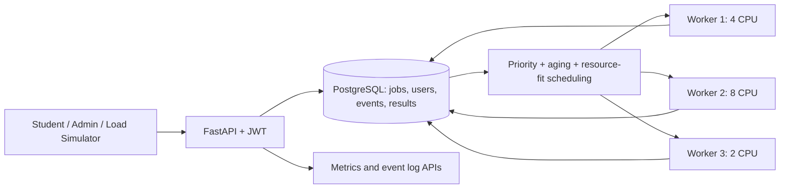

# P66 — Satellite Image Processing Job Scheduler

An individual cloud application project implementing authenticated job submission, resource-aware priority scheduling with aging, asynchronous workers, retry after worker failure, persistent raw request events and synthetic processing results, monitoring, and load testing.

**Important:** This is a working **simulated satellite-processing scheduler**. It does not process real raster data. Submitted metadata and results are stored in PostgreSQL, with raw requests captured in the `events` table. A database-backed queue is used rather than Redis, to keep scheduling decisions transactional and inspectable.

## Architecture



Components: REST API, persistent PostgreSQL queue/database, multiple independent workers, JWT authorization, logging and metrics. The scheduler selects the highest score among jobs that fit a worker's CPU/RAM. `score = priority_weight + waiting_seconds/3`; weights LOW=0, NORMAL=10, HIGH=20, EMERGENCY=40. Aging means a LOW job waiting 180 seconds outranks a newly arrived EMERGENCY job. PostgreSQL `FOR UPDATE SKIP LOCKED` protects concurrent claims. A stale RUNNING job whose heartbeat is older than 15 seconds is returned to the queue, up to 3 attempts.

## Run

Install Docker Desktop and Docker Compose. In this folder:

```bash
cp .env.example .env
# edit .env and replace all secrets
docker compose up --build -d
docker compose ps
```

Open **http://localhost:8000/docs** for interactive Swagger API documentation.

Login `POST /auth/login` with username `student` and password matching `STUDENT_PASSWORD` in `.env`; admin login uses `admin` and `ADMIN_PASSWORD`. Click **Authorize** in Swagger and paste the `access_token`.

Quick terminal demo (replace password):

```bash
TOKEN=$(curl -s -X POST http://localhost:8000/auth/login -H 'Content-Type: application/json' -d '{"username":"student","password":"YOUR_STUDENT_PASSWORD"}' | python -c 'import sys,json;print(json.load(sys.stdin)["access_token"])')
curl -X POST http://localhost:8000/jobs -H "Authorization: Bearer $TOKEN" -H 'Content-Type: application/json' -d '{"image_name":"flood_zone_023.tif","size_mb":1850,"processing_type":"flood_mapping","priority":"EMERGENCY","latitude":28.61,"longitude":77.21,"required_cpu":4,"required_memory_mb":4096}'
```

## APIs

| Method | Path | Access | Purpose |
|---|---|---|---|
| POST | `/auth/login` | Public | Issue JWT |
| POST | `/jobs` | User/Admin | Submit job, optional `Idempotency-Key` header |
| GET | `/jobs` | User/Admin | List owned jobs (admin sees all) |
| GET | `/jobs/{job_id}` | Owner/Admin | Inspect status and result |
| DELETE | `/jobs/{job_id}` | Owner/Admin | Cancel queued job |
| GET | `/scheduler/queue` | Admin | Ranked queue |
| GET | `/workers` | Admin | Worker resources and heartbeat |
| GET | `/events` | Admin | Persistent audit/events |
| GET | `/metrics` | Admin | Wait, duration, throughput, retries, fairness |
| GET | `/health` | Public | Health check |

Database entities: `users`, `jobs`, `workers`, `events`. PostgreSQL is appropriate for ACID job claims, concurrent locks, relational ownership, and auditable state transitions.

## Simulate 100+ jobs

Install Python dependencies (`pip install -r requirements.txt requests`) and run:

```bash
python scripts/simulate.py --count 100 --concurrency 10
python scripts/simulate.py --count 500 --concurrency 25
python scripts/simulate.py --count 1000 --concurrency 100
```

Alternatively run `locust -f locustfile.py --host http://localhost:8000` and select 5, 25, 100 users for low, medium and high loads. Record API p50/p95, request rate and failures in Locust, and completed-job metrics from `/metrics` after queues drain. **No performance figures are fabricated; measure on your own machine/deployment.**

## Failure/recovery experiment

1. Submit many jobs, including an 8-CPU job (worker2 is the only eligible worker).
2. Observe `/workers`, `/events`, and `/jobs` while the job is `RUNNING`.
3. Run `docker compose kill worker2` to simulate an abrupt worker crash.
4. Wait at least 15 seconds; another worker detects stale heartbeat and requeues the job. Restart with `docker compose up -d worker2`.
5. Confirm the job's `attempts` increases and its `JOB_RECOVERED` event appears. For a 2-CPU job, other live workers can pick it up without restarting worker2.
6. Record timestamps, screenshots and recovery time for the report.

**Limitation:** For reproducible classroom simulation, processing is time-scaled and capped at 12 seconds per attempt. To demonstrate a crash reliably, stop a worker immediately after a `JOB_STARTED` event; the worker may otherwise complete first. Worker health records are heartbeat snapshots and do not currently include explicit ONLINE/OFFLINE classification. Repeated submissions without an `Idempotency-Key` create separate jobs.

## Testing

Run tests locally or directly inside Docker:

```bash
# Locally
pip install -r requirements.txt
pytest -v

# Or inside Docker
docker compose exec api pytest -v
```

## Deployment

Deploy this Docker Compose stack to a cloud VM with Docker (e.g. AWS EC2, Azure VM, or GCP Compute Engine). Expose only the API behind HTTPS/reverse proxy, restrict database to the private network, replace demo credentials/secrets, enable persistent volume backups, and collect container logs. For public deployment, implement real account management/password hashing and robust rate limits first; the included fixed demo accounts are for classroom use only.

## Report checklist

Include architecture diagram, schema, endpoints/OpenAPI screenshots, 100-job input run, queue ranking, fairness test, worker-failure logs, metrics screenshots, low/medium/high Locust results, discussion of limitations, cloud deployment URL/screenshot, Git repo with >=8 meaningful commits, and viva explanation.
